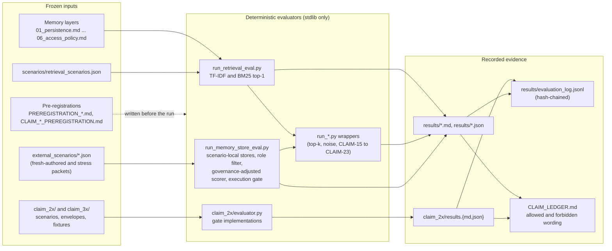
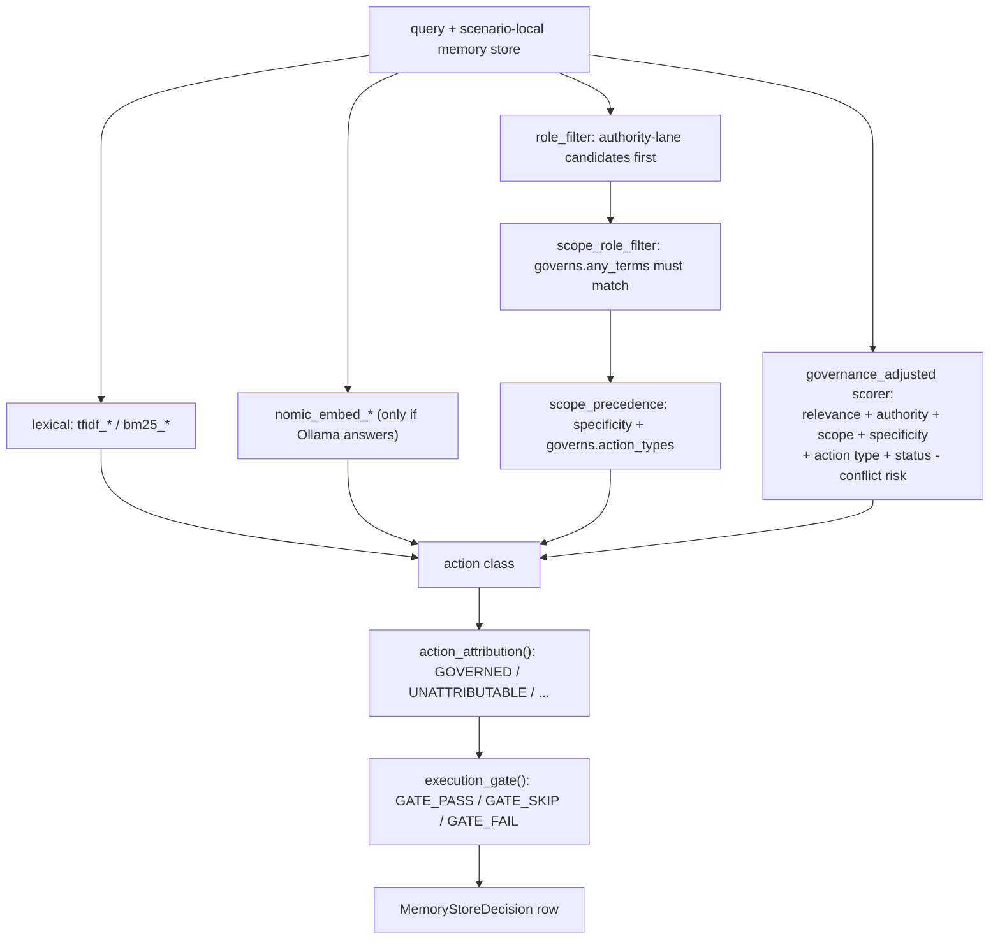

# Architecture

The repository is a claim-driven research trail, not an application. Each
public claim in `CLAIM_LEDGER.md` is backed by a frozen input (memory layers or
a scenario packet), a deterministic evaluator, and a recorded result. Later
claims moved from retrieval scoring to action gates, but the shape is the same.

## Evidence flow

## Layer 1: retrieval consequence (CLAIM-01 to CLAIM-07)

- Memory objects live as fenced JSON blocks inside the six `0N_*.md` layer
  files. `run_retrieval_eval.load_all_memories()` extracts them (21 objects).
- `scenarios/retrieval_scenarios.json` labels each query with the correct
  memory and the expected action class.
- `run_retrieval_eval.py` retrieves one memory per query (TF-IDF or BM25 over
  three text constructions), maps it to an action with `layered_action()`, and
  classifies the outcome with `score_decision()`:

| Outcome | Meaning |
|---|---|
| benign miss | wrong memory, right action |
| false certainty | risky query (`warn`, `verify_first`, `block`) got `answer` or `answer_context` |
| downgrade miss | wrong memory, protective but weaker action (for example `block` to `warn`) |
| overblocking | stricter action than expected |

- `run_topk_*.py` and `run_aligned_topk_aggregation_eval.py` reuse these
  helpers to test top-k aggregation of the s02 downgrade miss.
- `run_embedding_eval.py` swaps in Ollama embeddings.

## Layer 2: authority arbitration (CLAIM-08 to CLAIM-23)

`run_memory_store_eval.py` is the core of this layer. Each scenario carries its
own target and distractor memories. Strategies, in rough order of addition:

Most `run_claim1x_*.py` and `run_claim2x_*.py` scripts import scoring functions
from `run_memory_store_eval.py` and run them over one packet in
`external_scenarios/`. `run_memory_store_eval.py --scenarios <packet>` writes
`results/<packet stem>_results.{md,json}`.

## Layer 3: action gates and auditability (CLAIM-24 to CLAIM-31)

Each `claim_NN/` folder imports its sibling modules by bare name (for example
`from gate_interface import ...`), so run its files as scripts
(`python3 claim_25/evaluator.py` or `cd claim_25 && python3 evaluator.py`), not
as packages. `claim_27` reuses `claim_25`, and `claim_29` and `claim_30` reuse
`claim_28`, by inserting those folders on `sys.path`.

| Folder | Property under test | Entry point |
|---|---|---|
| `claim_24/` | Re-derive a grant from its live source before acting (FIPSign) | `evaluator.py`, `run_fipsign_live_eval.py`, `run_mandate_cell7.py`, `test_mandate_cell7.py` |
| `claim_25/` | Signed is not the same as fresh | `evaluator.py [core|ablations|full]` |
| `claim_26/` | Paired authority and action events | `evaluator.py [closing|baselines|full]` |
| `claim_27/` | Scope soundness of a source and sequence signature | `scope_soundness_evaluator.py` |
| `claim_28/` | Behavioral norms beyond authority | `evaluator.py` |
| `claim_29/` | Permission is not purpose | `evaluator.py`, `verify_frozen28_must_pass.py` |
| `claim_30/` | Compositional escape across steps | `evaluator.py` |
| `claim_31/` | Verified carryover across closes | `evaluator.py` |

Gate folders share a pattern: `gate_interface.py` defines records and an
abstract gate, several gate implementations (a naive baseline plus the
proposed gate and ablations), a frozen `scenarios*.json`, and an evaluator
that compares each gate's decision with the pre-registered expectation.

`claim_24/mandate_cell7.py` is the only code that performs authenticated
network I/O. It reads the project key from an environment variable, refuses
HTTP redirects so the key header is never forwarded, and writes private
capture artifacts with restrictive file modes.

## Integrity tooling

- `scripts/append_eval_log.py`: append-only JSONL log. Each event hashes the
  result, inputs, and evaluator files and chains to the previous event.
- `scripts/check_authority_patterns.py` with `.claude/security-patterns.json`:
  regex preflight for mislabeled authority metadata and overclaiming wording.
- `.claude/claude-security-guidance.md`: authoring rules for packets,
  evaluators, and claim wording.
